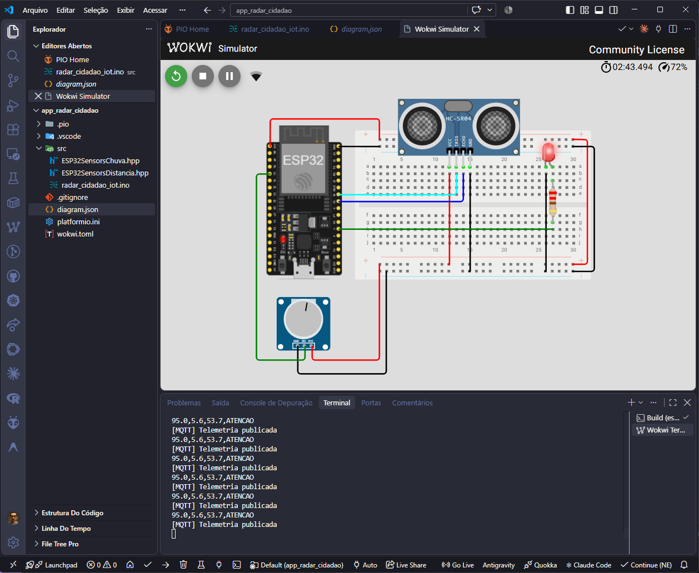
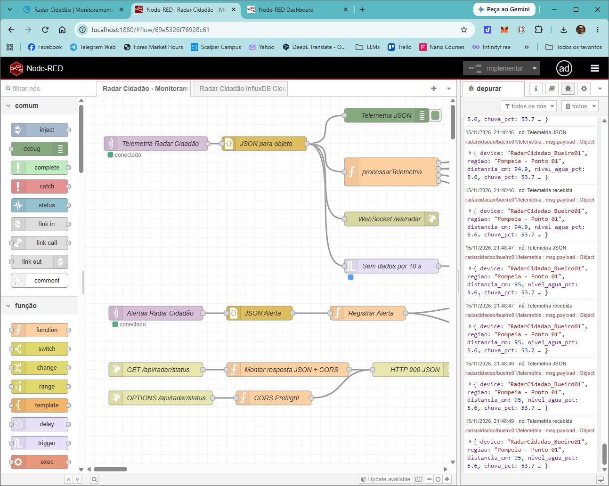
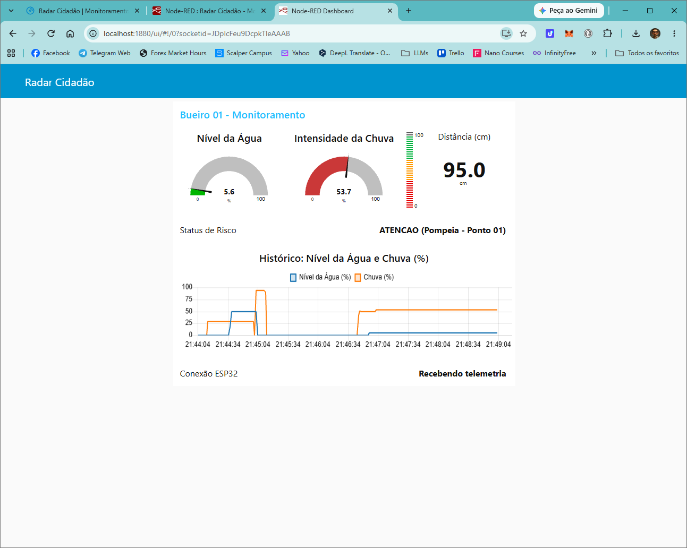
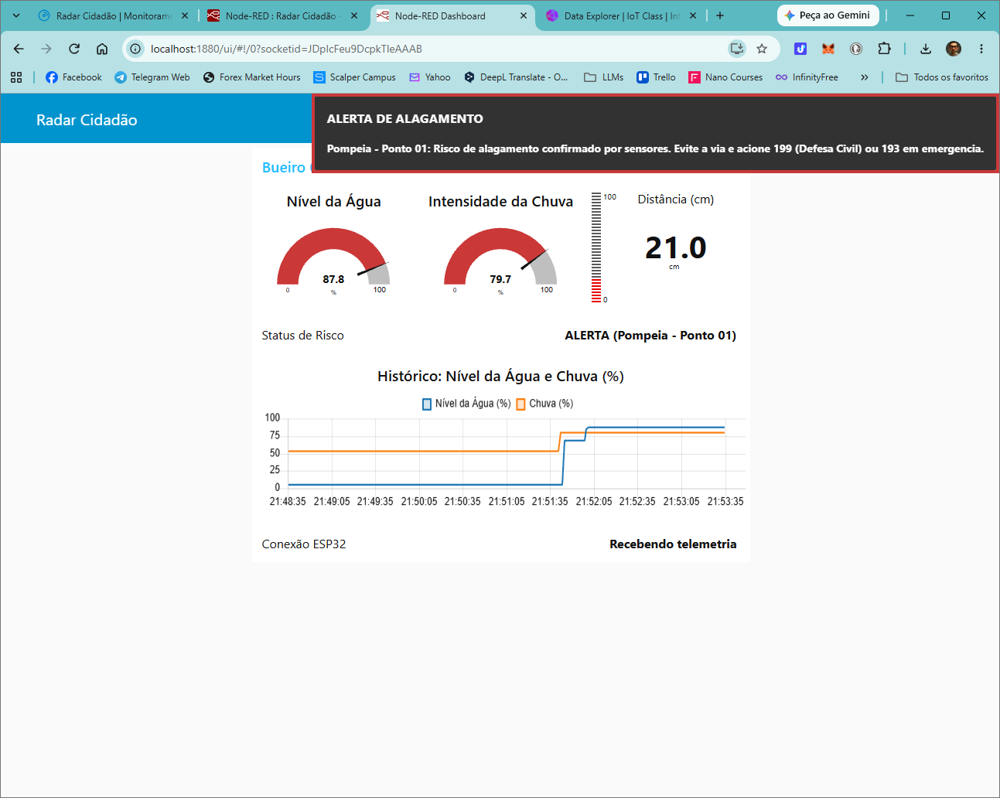
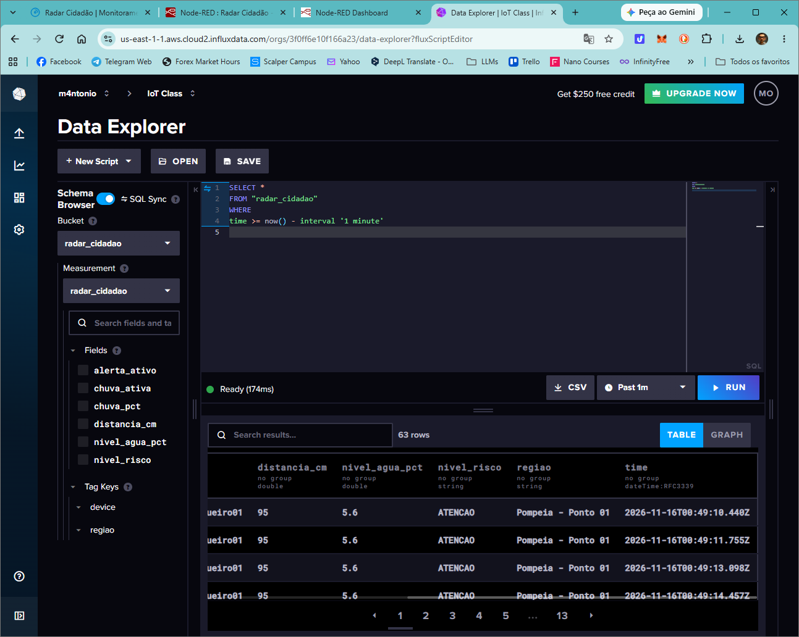
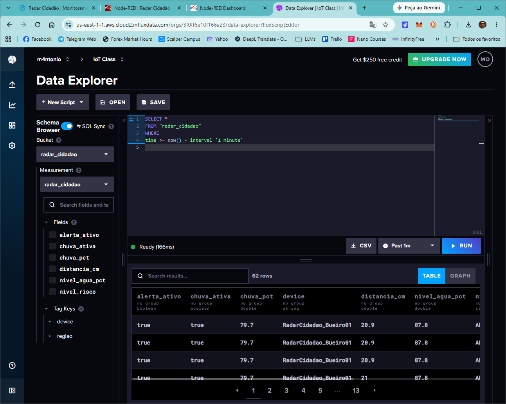
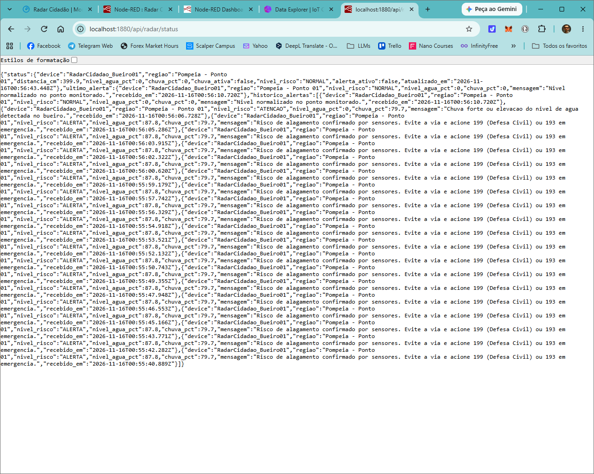
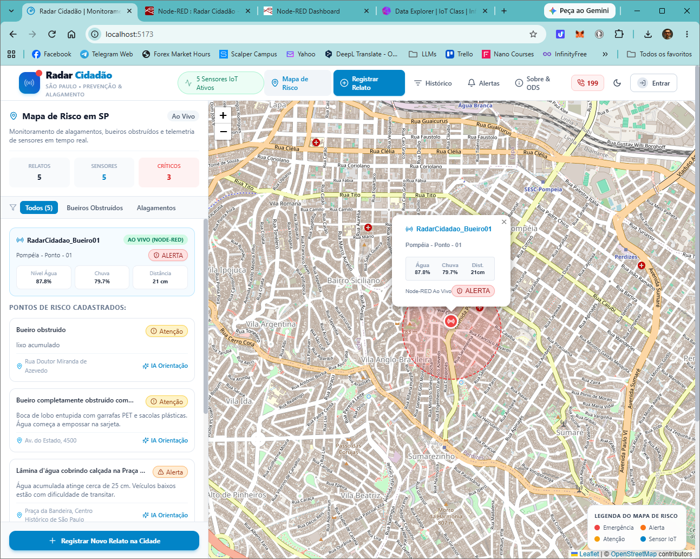

### IDENTIFICAÇÃO DO PROJETO, DO GRUPO E DA DISCIPLINA
- **Instituição:** FIAP — Global Solution 2026.2
- **Disciplina:** PHYSICAL COMPUTING, EMBEDDED AI, ROBOTICS & COGNITIVE IOT
- **Tema Central:** CitizenTech (Cidades Sustentáveis e Resiliência Urbana)
- **ODS Vinculados:** ODS 11 (Meta 11.5) e ODS 13 (Meta 13.1)
- **Projeto Integrador:** Radar Cidadão
- **Repositório:** [https://github.com/sarahmfurlan-sudo/radar-cidadao](https://github.com/sarahmfurlan-sudo/radar-cidadao)
- **Link do vídeo demonstrativo:** [Assistir ao vídeo](https://youtu.be/PKmweoWx3LY)

## 1. Identificação da Equipe
| Nome Completo | RM |
| :--- | :--- |
| Mario Antonio Oliveira | RM 567713 |
| Sarah Marangoni Furlan | RM 566764 |
| Vinicius Augusto Silva | RM 566830 |

## 1. Problema, Público Beneficiado e Relevância

Alagamentos em São Paulo provocam perdas materiais, interrompem a circulação urbana e colocam vidas em risco. Parte dessas ocorrências está associada a bueiros obstruídos por lixo e entulho em via pública, somada à chegada tardia da informação de risco à população e ao poder público.

O **Radar Cidadão** atua no caso de uso de chuva e alagamento: cidadãos registram um **relato** com foto e localização, sensores confirmam as condições físicas no ponto monitorado e a população recebe **alerta** para se proteger, complementando os canais oficiais (Defesa Civil `199` e Corpo de Bombeiros `193`).

**Público beneficiado:**
- Moradores e pessoas que circulam por áreas sujeitas a alagamento em São Paulo.
- Poder público (subprefeituras e **Defesa Civil**) como destino dos dados de **encaminhamento**.

## 2. Arquitetura da Solução e Comunicação MQTT

O módulo IoT cobre as etapas de **Confirmação por Sensores** e **Alerta** do fluxo do Radar Cidadão, seguindo a cadeia:

```text
[Sensores Simulados no Wokwi]
  ├─ HC-SR04 (distância até a lâmina d'água) ──> GPIO 19 (TRIG) / GPIO 18 (ECHO)
  └─ Potenciômetro (intensidade de chuva)    ──> GPIO 34 (ADC1)
        │
        ▼
[ESP32 DevKitC v4 — radar_cidadao_iot.ino]
  ├─ Atuador local: LED vermelho (GPIO 4 + resistor 220 Ω)
  └─ Publicação MQTT (Wi-Fi Wokwi-GUEST -> host.wokwi.internal:1883)
        │
        ▼
[Broker Eclipse Mosquitto (Docker)]
  ├─ Tópico de telemetria: radarcidadao/bueiro01/telemetria (a cada 1 s)
  └─ Tópico de alerta:     radarcidadao/bueiro01/alerta     (transição / estado ALERTA)
        │
        ▼
[Node-RED (Docker)]
  ├─ Fluxo 1 (Dashboard & API):
  │    ├─ Painel em tempo real (/ui): gauges, nível, histórico, status e toast de alerta
  │    ├─ API HTTP REST (GET /api/radar/status com CORS) para o app React + Vite
  │    └─ WebSocket (/ws/radar) para atualização em tempo real no Mapa de Risco
  └─ Fluxo 2 (Persistência):
       └─ Gravação contínua no InfluxDB Cloud (measurement: radar_cidadao)
```

### 2.1 Origem dos Dados e Pinagem (Simulação Wokwi)

| Componente | Função | Pino no ESP32 |
| --- | --- | --- |
| Sensor Ultrassônico `HC-SR04` | Mede a distância (cm) do topo do bueiro até a lâmina d'água; convertida em `nivel_agua_pct` (`100 cm` = `0%`, `10 cm` = `100%`). | `TRIG = GPIO 19`, `ECHO = GPIO 18` |
| Potenciômetro (`wokwi-potentiometer`) | Simula a intensidade de chuva contínua (`0%` a `100%`) via leitura analógica de 12 bits (`0..4095`). | `SIG = GPIO 34` |
| LED vermelho + Resistor `220 Ω` | Sinalização visual local do estado de risco no ponto monitorado. | `GPIO 4` |

### 2.2 Contrato de Mensagens MQTT (JSON)

**Tópico `radarcidadao/bueiro01/telemetria`:**
```json
{
  "device": "RadarCidadao_Bueiro01",
  "regiao": "Centro - Ponto 01",
  "distancia_cm": 25.0,
  "nivel_agua_pct": 83.3,
  "chuva_pct": 75.0,
  "chuva_ativa": true,
  "nivel_risco": "ALERTA",
  "alerta_ativo": true
}
```

**Tópico `radarcidadao/bueiro01/alerta`:**
```json
{
  "device": "RadarCidadao_Bueiro01",
  "regiao": "Centro - Ponto 01",
  "nivel_risco": "ALERTA",
  "nivel_agua_pct": 83.3,
  "chuva_pct": 75.0,
  "mensagem": "Risco de alagamento confirmado por sensores. Evite a via e acione 199 (Defesa Civil) ou 193 em emergencia."
}
```

## 3. Regras de Classificação, Testes e Evidências

### 3.1 Regras Implementadas no ESP32
- **`NORMAL`:** `nivel_agua_pct < 40%` e `chuva_pct < 50%` → LED apagado.
- **`ATENCAO`:** `nivel_agua_pct >= 40%` ou `chuva_pct >= 50%` → LED piscando (`500 ms`) e publicação de evento em `/alerta` na transição.
- **`ALERTA`:** (`nivel_agua_pct >= 70%` e `chuva_pct >= 50%`) ou `nivel_agua_pct >= 85%` → LED aceso fixo, publicação contínua em `/alerta`, notificação *toast* no Node-RED e atualização em `GET /api/radar/status`.

### 3.2 Resultados dos Testes (Situações de Entrada)

| Cenário | Entrada Simulada (Wokwi) | Saída Serial / MQTT | Efeito no LED e Solução |
| --- | --- | --- | --- |
| **1. Normal** | `HC-SR04 = 120 cm` (`0%` água), Potenciômetro = `0%` chuva | `nivel_risco = "NORMAL"`, `alerta_ativo = false` | LED apagado; registro gravado no InfluxDB Cloud e exibido como `NORMAL` no Dashboard. |
| **2. Atenção** | `HC-SR04 = 55 cm` (`50%` água) ou Potenciômetro `>= 50%` | `nivel_risco = "ATENCAO"`, `alerta_ativo = false` | LED piscando (`500 ms`); evento publicado em `radarcidadao/bueiro01/alerta`. |
| **3. Alerta** | `HC-SR04 = 25 cm` (`83.3%` água), Potenciômetro = `75%` chuva | `nivel_risco = "ALERTA"`, `alerta_ativo = true` | LED aceso fixo; *toast* vermelho no Node-RED `/ui`; `ultimo_alerta` atualizado em `/api/radar/status`. |

## 4. Limitações Identificadas (Real vs. Simulado)

- **Ambiente de hardware simulado:** O ESP32 e os sensores são executados no simulador Wokwi (`Wokwi-GUEST`), não refletindo ruídos elétricos, atenuação de sinal ou desgaste físico em campo.
- **Sensor de chuva substituído por potenciômetro:** Como o Wokwi não possui sensor de chuva capacitivo/resistivo nativo (ex.: YL-83), foi utilizado um potenciômetro analógico para reproduzir a variação contínua de intensidade (`0%` a `100%`).
- **Parâmetros fixos de geometria do bueiro:** A profundidade de referência (`ALTURA_BUEIRO_CM = 100.0`) e a distância mínima (`DIST_CRITICA_CM = 10.0`) são valores fixos de protótipo e exigiriam calibração individual por ponto instalado em via pública.
- **Autenticação local do broker:** O Mosquitto em ambiente Docker de laboratório opera sem autenticação de usuário/senha (`allow_anonymous true`) e sem TLS.

## 5. Relação com ODS

- **ODS 11 (Cidades e Comunidades Sustentáveis) — Meta 11.5:** Reduzir significativamente o número de mortes e perdas econômicas causadas por desastres, incluindo os relacionados à água, por meio da detecção antecipada de risco de alagamento e emissão de **alerta** à população.
- **ODS 13 (Ação Contra a Mudança Global do Clima) — Meta 13.1:** Reforçar a resiliência e a capacidade de adaptação a riscos relacionados ao clima por meio do monitoramento contínuo de eventos de chuva intensa e acúmulo de água.

## 6. Código Utilizado

### 6.1 `radar_cidadao_iot.ino`
```cpp
/* ---- Includes ---- */
#include <Arduino.h>
#include <WiFi.h>
#include <WiFiClient.h>
#include <PubSubClient.h>
#include <ArduinoJson.h>
#include "ESP32SensorsDistancia.hpp"
#include "ESP32SensorsChuva.hpp"

/* ---- Config Hardware (alinhado ao diagram.json) ---- */
const uint8_t TRIG_PIN = 19;
const uint8_t ECHO_PIN = 18;
const uint8_t CHUVA_PIN = 34;       // Potenciometro simulando intensidade de chuva (ADC1)
const uint8_t LED_ALERTA_PIN = 4;   // LED vermelho de alerta local

/* ---- Parametros do Bueiro / Limiares de Risco ---- */
const float ALTURA_BUEIRO_CM = 100.0f;   // Profundidade de referencia (sensor ate o fundo seco)
const float DIST_CRITICA_CM = 10.0f;     // Distancia minima ate a tampa (100% cheio)
const float LIMIAR_CHUVA_ATIVA = 20.0f;  // >= 20% indica chuva ativa
const float LIMIAR_CHUVA_FORTE = 50.0f;  // >= 50% indica chuva forte
const float LIMIAR_AGUA_ATENCAO = 40.0f; // >= 40% nivel de atencao
const float LIMIAR_AGUA_ALERTA = 70.0f;  // >= 70% + chuva forte (ou >= 85% isolado) = ALERTA

/* ---- Config Wi-Fi e MQTT ---- */
const char* WIFI_SSID = "Wokwi-GUEST";
const char* WIFI_PASSWORD = "";
#define MQTT_SERVER "host.wokwi.internal"
#define MQTT_PORT 1883
#define MQTT_CLIENT_ID "RadarCidadao_Bueiro01"
#define REGIAO_PONTO "Centro - Ponto 01"
#define MQTT_PUB_TELEMETRIA "radarcidadao/bueiro01/telemetria"
#define MQTT_PUB_ALERTA "radarcidadao/bueiro01/alerta"

WiFiClient wifiClient;
PubSubClient mqttClient(wifiClient);

/* ---- Controle de intervalo ---- */
const unsigned long INTERVALO_COLETA = 1000;
const unsigned long INTERVALO_RECONEXAO = 5000;
const unsigned long INTERVALO_PISCA_LED = 500;
unsigned long tempoAnterior = 0;
unsigned long ultimaTentativaWiFi = 0;
unsigned long ultimaTentativaMQTT = 0;
unsigned long ultimoPiscaLed = 0;
bool estadoLed = false;

/* ---- Estado atual ---- */
float distanciaCm = NAN;
float nivelAguaPct = 0.0f;
float chuvaPct = 0.0f;
String nivelRisco = "NORMAL";
String riscoAnterior = "NORMAL";

/* ---- Prototipos ---- */
void conectarWiFi();
void conectarMQTT();
float calcularNivelAguaPct(float distCm);
String classificarRisco(float aguaPct, float chuva);
void atualizarLedAlerta();
bool publicarTelemetria();
void publicarAlertaSeNecessario();

void setup() {
  Serial.begin(115200);
  pinMode(LED_ALERTA_PIN, OUTPUT);
  digitalWrite(LED_ALERTA_PIN, LOW);

  ESP32Sensors::Distancia::inicializar(TRIG_PIN, ECHO_PIN);
  ESP32Sensors::Chuva::inicializar(CHUVA_PIN);

  delay(INTERVALO_RECONEXAO);
  conectarWiFi();
  mqttClient.setServer(MQTT_SERVER, MQTT_PORT);
  mqttClient.setBufferSize(768);
  mqttClient.setKeepAlive(120);

  Serial.println("distancia_cm,nivel_agua_pct,chuva_pct,nivel_risco");
}

void loop() {
  if (millis() - tempoAnterior >= INTERVALO_COLETA) {
    tempoAnterior = millis();

    distanciaCm = ESP32Sensors::Distancia::medirDistancia();
    nivelAguaPct = calcularNivelAguaPct(distanciaCm);
    chuvaPct = ESP32Sensors::Chuva::medirIntensidadePct();
    nivelRisco = classificarRisco(nivelAguaPct, chuvaPct);

    publicarTelemetria();
    publicarAlertaSeNecessario();
    riscoAnterior = nivelRisco;
  }

  atualizarLedAlerta();

  if (WiFi.status() != WL_CONNECTED) {
    conectarWiFi();
  } else if (!mqttClient.connected()) {
    conectarMQTT();
  } else {
    mqttClient.loop();
  }
}

float calcularNivelAguaPct(float distCm) {
  if (isnan(distCm) || distCm >= ALTURA_BUEIRO_CM) {
    return 0.0f;
  }
  if (distCm <= DIST_CRITICA_CM) {
    return 100.0f;
  }
  float pct = ((ALTURA_BUEIRO_CM - distCm) / (ALTURA_BUEIRO_CM - DIST_CRITICA_CM)) * 100.0f;
  return constrain(pct, 0.0f, 100.0f);
}

String classificarRisco(float aguaPct, float chuva) {
  if ((aguaPct >= LIMIAR_AGUA_ALERTA && chuva >= LIMIAR_CHUVA_FORTE) || aguaPct >= 85.0f) {
    return "ALERTA";
  }
  if (aguaPct >= LIMIAR_AGUA_ATENCAO || chuva >= LIMIAR_CHUVA_FORTE) {
    return "ATENCAO";
  }
  return "NORMAL";
}

void atualizarLedAlerta() {
  if (nivelRisco == "ALERTA") {
    digitalWrite(LED_ALERTA_PIN, HIGH);
  } else if (nivelRisco == "ATENCAO") {
    if (millis() - ultimoPiscaLed >= INTERVALO_PISCA_LED) {
      ultimoPiscaLed = millis();
      estadoLed = !estadoLed;
      digitalWrite(LED_ALERTA_PIN, estadoLed ? HIGH : LOW);
    }
  } else {
    estadoLed = false;
    digitalWrite(LED_ALERTA_PIN, LOW);
  }
}

void conectarWiFi() {
  if (millis() - ultimaTentativaWiFi < INTERVALO_RECONEXAO) {
    return;
  }
  ultimaTentativaWiFi = millis();

  WiFi.mode(WIFI_STA);
  WiFi.begin(WIFI_SSID, WIFI_PASSWORD);
  WiFi.setSleep(false);
}

void conectarMQTT() {
  if (millis() - ultimaTentativaMQTT < INTERVALO_RECONEXAO) {
    return;
  }
  ultimaTentativaMQTT = millis();

  if (mqttClient.connect(MQTT_CLIENT_ID)) {
    Serial.println("[MQTT] Conectado ao broker");
  } else {
    Serial.printf("[MQTT] Falha na conexao: %d\r\n", mqttClient.state());
  }
}

bool publicarTelemetria() {
  Serial.printf("%.1f,%.1f,%.1f,%s\r\n",
                isnan(distanciaCm) ? -1.0f : distanciaCm,
                nivelAguaPct,
                chuvaPct,
                nivelRisco.c_str());

  JsonDocument doc;
  doc["device"] = MQTT_CLIENT_ID;
  doc["regiao"] = REGIAO_PONTO;
  doc["distancia_cm"] = isnan(distanciaCm) ? -1.0f : roundf(distanciaCm * 10.0f) / 10.0f;
  doc["nivel_agua_pct"] = roundf(nivelAguaPct * 10.0f) / 10.0f;
  doc["chuva_pct"] = roundf(chuvaPct * 10.0f) / 10.0f;
  doc["chuva_ativa"] = (chuvaPct >= LIMIAR_CHUVA_ATIVA);
  doc["nivel_risco"] = nivelRisco;
  doc["alerta_ativo"] = (nivelRisco == "ALERTA");

  String payload;
  serializeJson(doc, payload);
  if (!mqttClient.connected()) {
    return false;
  }
  bool ok = mqttClient.publish(MQTT_PUB_TELEMETRIA, payload.c_str());
  Serial.println(ok ? "[MQTT] Telemetria publicada" : "[MQTT] Falha ao publicar telemetria");
  return ok;
}

void publicarAlertaSeNecessario() {
  if (!mqttClient.connected()) {
    return;
  }
  if (nivelRisco == "ALERTA" || nivelRisco != riscoAnterior) {
    JsonDocument doc;
    doc["device"] = MQTT_CLIENT_ID;
    doc["regiao"] = REGIAO_PONTO;
    doc["nivel_risco"] = nivelRisco;
    doc["nivel_agua_pct"] = roundf(nivelAguaPct * 10.0f) / 10.0f;
    doc["chuva_pct"] = roundf(chuvaPct * 10.0f) / 10.0f;
    doc["mensagem"] = (nivelRisco == "ALERTA")
      ? "Risco de alagamento confirmado por sensores. Evite a via e acione 199 (Defesa Civil) ou 193 em emergencia."
      : (nivelRisco == "ATENCAO"
        ? "Chuva forte ou elevacao do nivel de agua detectada no bueiro."
        : "Nivel normalizado no ponto monitorado.");

    String payload;
    serializeJson(doc, payload);
    mqttClient.publish(MQTT_PUB_ALERTA, payload.c_str());
  }
}
```

### 6.2 `ESP32SensorsDistancia.hpp`
```cpp
#pragma once
#include <Arduino.h>

namespace ESP32Sensors {
  namespace Distancia {
    static uint8_t trigPin = 0;
    static uint8_t echoPin = 0;

    void inicializar(uint8_t tPin, uint8_t ePin) {
      trigPin = tPin;
      echoPin = ePin;
      pinMode(trigPin, OUTPUT);
      pinMode(echoPin, INPUT);
    }

    // Devolve cm, ou NAN quando nao volta eco.
    float medirDistancia() {
      digitalWrite(trigPin, LOW);
      delayMicroseconds(2);
      digitalWrite(trigPin, HIGH);
      delayMicroseconds(10);
      digitalWrite(trigPin, LOW);

      unsigned long duracao = pulseIn(echoPin, HIGH, 30000);
      return duracao ? duracao * 0.034f / 2 : NAN;
    }
  }
}
```

### 6.3 `ESP32SensorsChuva.hpp`
```cpp
#pragma once
#include <Arduino.h>

namespace ESP32Sensors {
  namespace Chuva {
    static uint8_t pino = 0;

    void inicializar(uint8_t adcPin) {
      pino = adcPin;
      pinMode(pino, INPUT);
    }

    // Converte a leitura ADC (0..4095) em intensidade simulada de chuva (0..100%).
    float medirIntensidadePct() {
      int leitura = analogRead(pino);
      return (leitura / 4095.0f) * 100.0f;
    }
  }
}
```

## 7. Evidências visuais

**Prints – Circuito no Wokwi**




**Prints – Node-RED MQTT e Dashboard**





**Prints – Consulta SQL no InfluxDB Cloud**




**Print – Endpoint da API**



**Print – Integração com FrontEnd**

