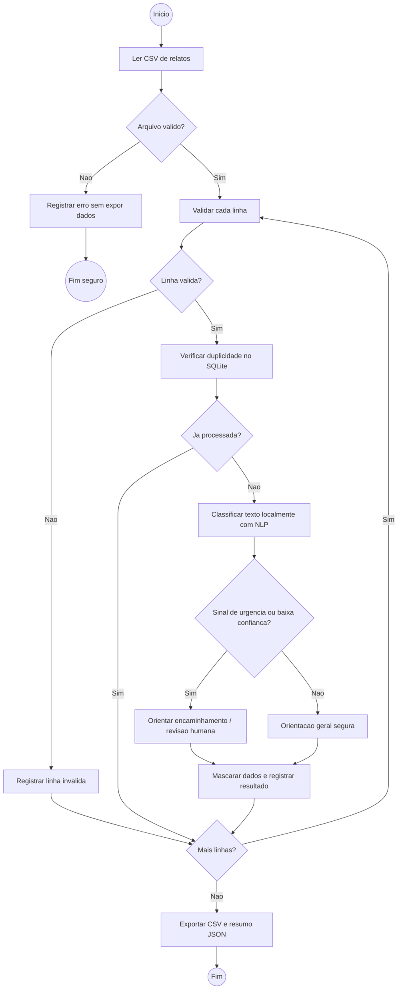

# Fluxo de processo - BPM e BPMN (representacao simplificada)

O desenho usa evento inicial/final, tarefas e gateways de decisao. Nao representa integracao com a Defesa Civil: o sistema gera uma recomendacao, mas nao envia chamados externos.

**Limites:** prototipo academico; nao realiza diagnostico, previsao, despacho ou alerta oficial. Regras e modelos pequenos nao validam risco geotecnico ou meteorologico real.
